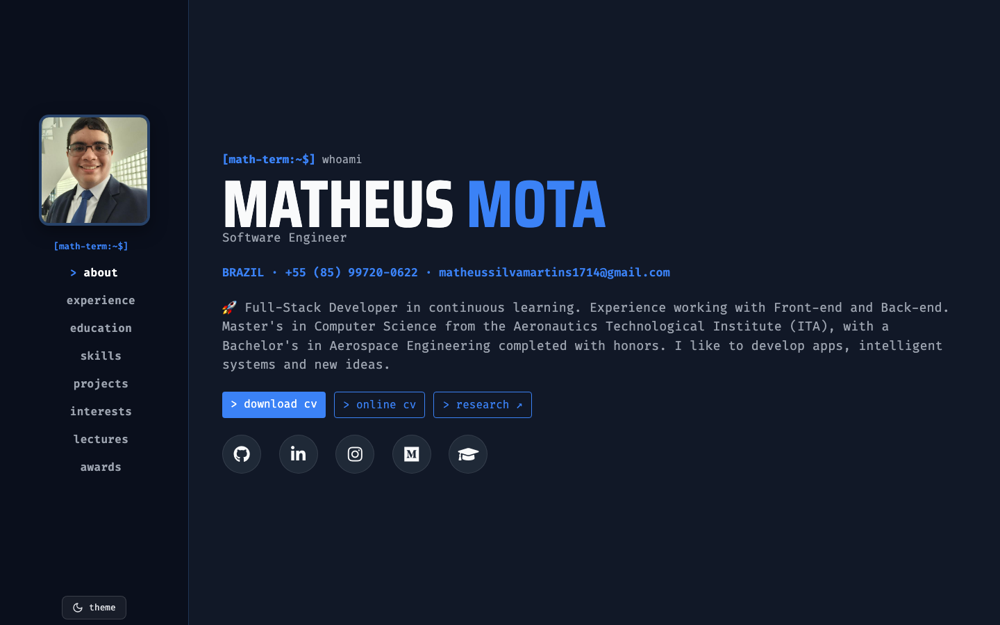

# [Resume - Matheus Mota](https://matheusmota-dev-br.github.io/portifolio-v1/)

My resume / portfolio, built with the design system of
[matheusmota.dev.br](https://matheusmota.dev.br) (`@matheusmota-dev-br/ui`, a
private package on GitHub Packages): React + Vite + Tailwind, deployed to
GitHub Pages.

## Preview

[](https://matheusmota-dev-br.github.io/portifolio-v1/)

## Content

All the text lives in `src/content.ts` and `src/resume.ts` (experience and
education). The page composition is in `src/app.tsx`, using only components
from the design system.

## Development

The design system is private, so installing needs a GitHub token (classic)
with the `read:packages` scope, read by `.npmrc`:

```bash
export GH_MATHEUS_MOTA_UI=ghp_xxx
pnpm install
pnpm dev
```

## Deploy and updates

- Every push to `master` builds and publishes to GitHub Pages
  (`.github/workflows/deploy.yml`). The token comes from the `GH_MATHEUS_MOTA_UI`
  secret of the `envs` environment.
- `master` only changes through pull requests: direct pushes, force pushes and
  deleting the branch are blocked, and a PR can only be merged after the build
  check (`.github/workflows/build-check.yml`, the same build as the deploy)
  passes.
- New versions of the design system arrive as PRs: Dependabot checks daily for
  a new `@matheusmota-dev-br/ui` and opens a PR with the build check on it; the
  merge is manual. Dependabot reads the token from its own secret with the same
  name (Settings → Secrets and variables → Dependabot).

## License

[MIT](LICENSE).
